<!--
  Muhammad Kamran Ashraf — GitHub profile.
  Every image here is hand-built SVG: scripts/build_assets.py renders the artwork (dark + light),
  scripts/stats.py renders live telemetry twice a day via .github/workflows/profile.yml.
  No third-party stat widgets, no tracking pixels.
-->

<picture><source media="(prefers-color-scheme: dark)" srcset="https://raw.githubusercontent.com/Kamran5H/Kamran5H/main/assets/svg/hero-dark.svg"><source media="(prefers-color-scheme: light)" srcset="https://raw.githubusercontent.com/Kamran5H/Kamran5H/main/assets/svg/hero-light.svg"></picture>

<a href="#about"><picture><source media="(prefers-color-scheme: dark)" srcset="https://raw.githubusercontent.com/Kamran5H/Kamran5H/main/assets/svg/nav-about-dark.svg"><source media="(prefers-color-scheme: light)" srcset="https://raw.githubusercontent.com/Kamran5H/Kamran5H/main/assets/svg/nav-about-light.svg"></picture></a>
<a href="#work"><picture><source media="(prefers-color-scheme: dark)" srcset="https://raw.githubusercontent.com/Kamran5H/Kamran5H/main/assets/svg/nav-work-dark.svg"><source media="(prefers-color-scheme: light)" srcset="https://raw.githubusercontent.com/Kamran5H/Kamran5H/main/assets/svg/nav-work-light.svg"></picture></a>
<a href="#builds"><picture><source media="(prefers-color-scheme: dark)" srcset="https://raw.githubusercontent.com/Kamran5H/Kamran5H/main/assets/svg/nav-builds-dark.svg"><source media="(prefers-color-scheme: light)" srcset="https://raw.githubusercontent.com/Kamran5H/Kamran5H/main/assets/svg/nav-builds-light.svg"></picture></a>
<a href="#stack"><picture><source media="(prefers-color-scheme: dark)" srcset="https://raw.githubusercontent.com/Kamran5H/Kamran5H/main/assets/svg/nav-stack-dark.svg"><source media="(prefers-color-scheme: light)" srcset="https://raw.githubusercontent.com/Kamran5H/Kamran5H/main/assets/svg/nav-stack-light.svg"></picture></a>
<a href="#research"><picture><source media="(prefers-color-scheme: dark)" srcset="https://raw.githubusercontent.com/Kamran5H/Kamran5H/main/assets/svg/nav-research-dark.svg"><source media="(prefers-color-scheme: light)" srcset="https://raw.githubusercontent.com/Kamran5H/Kamran5H/main/assets/svg/nav-research-light.svg"></picture></a>
<a href="#contact"><picture><source media="(prefers-color-scheme: dark)" srcset="https://raw.githubusercontent.com/Kamran5H/Kamran5H/main/assets/svg/nav-contact-dark.svg"><source media="(prefers-color-scheme: light)" srcset="https://raw.githubusercontent.com/Kamran5H/Kamran5H/main/assets/svg/nav-contact-light.svg"></picture></a>

 

<picture><source media="(prefers-color-scheme: dark)" srcset="https://raw.githubusercontent.com/Kamran5H/Kamran5H/main/assets/svg/h-about-dark.svg"><source media="(prefers-color-scheme: light)" srcset="https://raw.githubusercontent.com/Kamran5H/Kamran5H/main/assets/svg/h-about-light.svg"></picture>

<picture><source media="(prefers-color-scheme: dark)" srcset="https://raw.githubusercontent.com/Kamran5H/Kamran5H/main/assets/svg/about-dark.svg"><source media="(prefers-color-scheme: light)" srcset="https://raw.githubusercontent.com/Kamran5H/Kamran5H/main/assets/svg/about-light.svg"></picture>

> I'm an MPhil chemistry scholar at **Quaid-i-Azam University** who builds software the way an experimentalist runs a lab:
> state the hypothesis, control the variables, make the result reproducible. By day that means polymer-nanocomposite
> biosensors and DFT spectra; by night, local-first AI agents, resilient scrapers and the desktop tools I wish existed.

<b>The 30-second version for recruiters</b>

 

- **Builds end to end:** Python & TypeScript back ends (FastAPI, Flask, Express), browser automation (Playwright, Chrome MV3), desktop apps (Electron, CustomTkinter).
- **Ships AI responsibly:** agentic loops with human-approval gates, local-first data, streaming UIs.
- **Tests what he ships:** flagship repos carry automated suites (Quidian alone runs 152 tests).
- **Brings a scientist's rigor:** computational chemistry (Quantum ESPRESSO / DFT), instrument data (FTIR, UV-Vis), and literature tooling.
- **Has a live product:** [qaukalam.me](https://qaukalam.me), a platform for Quaid-i-Azam University students.

 

<picture><source media="(prefers-color-scheme: dark)" srcset="https://raw.githubusercontent.com/Kamran5H/Kamran5H/main/assets/svg/h-work-dark.svg"><source media="(prefers-color-scheme: light)" srcset="https://raw.githubusercontent.com/Kamran5H/Kamran5H/main/assets/svg/h-work-light.svg"></picture>

<a href="https://github.com/Kamran5H/AI-Coding"><picture><source media="(prefers-color-scheme: dark)" srcset="https://raw.githubusercontent.com/Kamran5H/Kamran5H/main/assets/svg/work-ai-coding-dark.svg"><source media="(prefers-color-scheme: light)" srcset="https://raw.githubusercontent.com/Kamran5H/Kamran5H/main/assets/svg/work-ai-coding-light.svg"></picture></a>
<a href="https://github.com/Kamran5H/Quidian-MediaDownloader"><picture><source media="(prefers-color-scheme: dark)" srcset="https://raw.githubusercontent.com/Kamran5H/Kamran5H/main/assets/svg/work-quidian-mediadownloader-dark.svg"><source media="(prefers-color-scheme: light)" srcset="https://raw.githubusercontent.com/Kamran5H/Kamran5H/main/assets/svg/work-quidian-mediadownloader-light.svg"></picture></a>

<a href="https://github.com/Kamran5H/Subah-TaskBook"><picture><source media="(prefers-color-scheme: dark)" srcset="https://raw.githubusercontent.com/Kamran5H/Kamran5H/main/assets/svg/work-subah-taskbook-dark.svg"><source media="(prefers-color-scheme: light)" srcset="https://raw.githubusercontent.com/Kamran5H/Kamran5H/main/assets/svg/work-subah-taskbook-light.svg"></picture></a>
<a href="https://github.com/Kamran5H/ArticlesDownloader"><picture><source media="(prefers-color-scheme: dark)" srcset="https://raw.githubusercontent.com/Kamran5H/Kamran5H/main/assets/svg/work-articlesdownloader-dark.svg"><source media="(prefers-color-scheme: light)" srcset="https://raw.githubusercontent.com/Kamran5H/Kamran5H/main/assets/svg/work-articlesdownloader-light.svg"></picture></a>

<b>Architecture notes</b> — how the AI-Coding agent stays safe

 

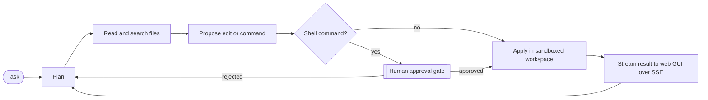

The model never touches the terminal on its own. Every command is shown to a human first, and the agent is confined to its workspace directory.

 

<picture><source media="(prefers-color-scheme: dark)" srcset="https://raw.githubusercontent.com/Kamran5H/Kamran5H/main/assets/svg/h-builds-dark.svg"><source media="(prefers-color-scheme: light)" srcset="https://raw.githubusercontent.com/Kamran5H/Kamran5H/main/assets/svg/h-builds-light.svg"></picture>

<picture><source media="(prefers-color-scheme: dark)" srcset="https://raw.githubusercontent.com/Kamran5H/Kamran5H/main/assets/svg/legend-dark.svg"><source media="(prefers-color-scheme: light)" srcset="https://raw.githubusercontent.com/Kamran5H/Kamran5H/main/assets/svg/legend-light.svg">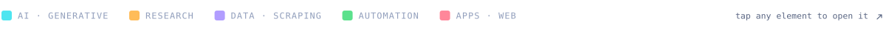</picture>

<a href="https://github.com/Kamran5H/AI-Coding"><picture><source media="(prefers-color-scheme: dark)" srcset="https://raw.githubusercontent.com/Kamran5H/Kamran5H/main/assets/svg/el-ai-coding-dark.svg"><source media="(prefers-color-scheme: light)" srcset="https://raw.githubusercontent.com/Kamran5H/Kamran5H/main/assets/svg/el-ai-coding-light.svg"></picture></a>
<a href="https://github.com/Kamran5H/Humanizer"><picture><source media="(prefers-color-scheme: dark)" srcset="https://raw.githubusercontent.com/Kamran5H/Kamran5H/main/assets/svg/el-humanizer-dark.svg"><source media="(prefers-color-scheme: light)" srcset="https://raw.githubusercontent.com/Kamran5H/Kamran5H/main/assets/svg/el-humanizer-light.svg"></picture></a>
<a href="https://github.com/Kamran5H/VideoStudio"><picture><source media="(prefers-color-scheme: dark)" srcset="https://raw.githubusercontent.com/Kamran5H/Kamran5H/main/assets/svg/el-videostudio-dark.svg"><source media="(prefers-color-scheme: light)" srcset="https://raw.githubusercontent.com/Kamran5H/Kamran5H/main/assets/svg/el-videostudio-light.svg"></picture></a>
<a href="https://github.com/Kamran5H/Urdu-Poetry-Studio"><picture><source media="(prefers-color-scheme: dark)" srcset="https://raw.githubusercontent.com/Kamran5H/Kamran5H/main/assets/svg/el-urdu-poetry-studio-dark.svg"><source media="(prefers-color-scheme: light)" srcset="https://raw.githubusercontent.com/Kamran5H/Kamran5H/main/assets/svg/el-urdu-poetry-studio-light.svg"></picture></a>
<a href="https://github.com/Kamran5H/ArticlesDownloader"><picture><source media="(prefers-color-scheme: dark)" srcset="https://raw.githubusercontent.com/Kamran5H/Kamran5H/main/assets/svg/el-articlesdownloader-dark.svg"><source media="(prefers-color-scheme: light)" srcset="https://raw.githubusercontent.com/Kamran5H/Kamran5H/main/assets/svg/el-articlesdownloader-light.svg"></picture></a>

<a href="https://github.com/Kamran5H/ReviewForge"><picture><source media="(prefers-color-scheme: dark)" srcset="https://raw.githubusercontent.com/Kamran5H/Kamran5H/main/assets/svg/el-reviewforge-dark.svg"><source media="(prefers-color-scheme: light)" srcset="https://raw.githubusercontent.com/Kamran5H/Kamran5H/main/assets/svg/el-reviewforge-light.svg"></picture></a>
<a href="https://github.com/Kamran5H/ResearchDaybook"><picture><source media="(prefers-color-scheme: dark)" srcset="https://raw.githubusercontent.com/Kamran5H/Kamran5H/main/assets/svg/el-researchdaybook-dark.svg"><source media="(prefers-color-scheme: light)" srcset="https://raw.githubusercontent.com/Kamran5H/Kamran5H/main/assets/svg/el-researchdaybook-light.svg"></picture></a>
<a href="https://github.com/Kamran5H/Early-Coding-Archive"><picture><source media="(prefers-color-scheme: dark)" srcset="https://raw.githubusercontent.com/Kamran5H/Kamran5H/main/assets/svg/el-early-coding-archive-dark.svg"><source media="(prefers-color-scheme: light)" srcset="https://raw.githubusercontent.com/Kamran5H/Kamran5H/main/assets/svg/el-early-coding-archive-light.svg"></picture></a>
<a href="https://github.com/Kamran5H/SourceGenius"><picture><source media="(prefers-color-scheme: dark)" srcset="https://raw.githubusercontent.com/Kamran5H/Kamran5H/main/assets/svg/el-sourcegenius-dark.svg"><source media="(prefers-color-scheme: light)" srcset="https://raw.githubusercontent.com/Kamran5H/Kamran5H/main/assets/svg/el-sourcegenius-light.svg"></picture></a>
<a href="https://github.com/Kamran5H/SourceGenius-Share"><picture><source media="(prefers-color-scheme: dark)" srcset="https://raw.githubusercontent.com/Kamran5H/Kamran5H/main/assets/svg/el-sourcegenius-share-dark.svg"><source media="(prefers-color-scheme: light)" srcset="https://raw.githubusercontent.com/Kamran5H/Kamran5H/main/assets/svg/el-sourcegenius-share-light.svg"></picture></a>

<a href="https://github.com/Kamran5H/BrandScrapers"><picture><source media="(prefers-color-scheme: dark)" srcset="https://raw.githubusercontent.com/Kamran5H/Kamran5H/main/assets/svg/el-brandscrapers-dark.svg"><source media="(prefers-color-scheme: light)" srcset="https://raw.githubusercontent.com/Kamran5H/Kamran5H/main/assets/svg/el-brandscrapers-light.svg"></picture></a>
<a href="https://github.com/Kamran5H/TikTokProductHunter"><picture><source media="(prefers-color-scheme: dark)" srcset="https://raw.githubusercontent.com/Kamran5H/Kamran5H/main/assets/svg/el-tiktokproducthunter-dark.svg"><source media="(prefers-color-scheme: light)" srcset="https://raw.githubusercontent.com/Kamran5H/Kamran5H/main/assets/svg/el-tiktokproducthunter-light.svg"></picture></a>
<a href="https://github.com/Kamran5H/Quidian-MediaDownloader"><picture><source media="(prefers-color-scheme: dark)" srcset="https://raw.githubusercontent.com/Kamran5H/Kamran5H/main/assets/svg/el-quidian-mediadownloader-dark.svg"><source media="(prefers-color-scheme: light)" srcset="https://raw.githubusercontent.com/Kamran5H/Kamran5H/main/assets/svg/el-quidian-mediadownloader-light.svg"></picture></a>
<a href="https://github.com/Kamran5H/GmailZenith"><picture><source media="(prefers-color-scheme: dark)" srcset="https://raw.githubusercontent.com/Kamran5H/Kamran5H/main/assets/svg/el-gmailzenith-dark.svg"><source media="(prefers-color-scheme: light)" srcset="https://raw.githubusercontent.com/Kamran5H/Kamran5H/main/assets/svg/el-gmailzenith-light.svg"></picture></a>
<a href="https://github.com/Kamran5H/FacebookCleaner"><picture><source media="(prefers-color-scheme: dark)" srcset="https://raw.githubusercontent.com/Kamran5H/Kamran5H/main/assets/svg/el-facebookcleaner-dark.svg"><source media="(prefers-color-scheme: light)" srcset="https://raw.githubusercontent.com/Kamran5H/Kamran5H/main/assets/svg/el-facebookcleaner-light.svg"></picture></a>

<a href="https://github.com/Kamran5H/DiskOptimizerPro"><picture><source media="(prefers-color-scheme: dark)" srcset="https://raw.githubusercontent.com/Kamran5H/Kamran5H/main/assets/svg/el-diskoptimizerpro-dark.svg"><source media="(prefers-color-scheme: light)" srcset="https://raw.githubusercontent.com/Kamran5H/Kamran5H/main/assets/svg/el-diskoptimizerpro-light.svg"></picture></a>
<a href="https://github.com/Kamran5H/ChromeMonitor"><picture><source media="(prefers-color-scheme: dark)" srcset="https://raw.githubusercontent.com/Kamran5H/Kamran5H/main/assets/svg/el-chromemonitor-dark.svg"><source media="(prefers-color-scheme: light)" srcset="https://raw.githubusercontent.com/Kamran5H/Kamran5H/main/assets/svg/el-chromemonitor-light.svg"></picture></a>
<a href="https://github.com/Kamran5H/AutoClearExtension"><picture><source media="(prefers-color-scheme: dark)" srcset="https://raw.githubusercontent.com/Kamran5H/Kamran5H/main/assets/svg/el-autoclearextension-dark.svg"><source media="(prefers-color-scheme: light)" srcset="https://raw.githubusercontent.com/Kamran5H/Kamran5H/main/assets/svg/el-autoclearextension-light.svg"></picture></a>
<a href="https://github.com/Kamran5H/Subah-TaskBook"><picture><source media="(prefers-color-scheme: dark)" srcset="https://raw.githubusercontent.com/Kamran5H/Kamran5H/main/assets/svg/el-subah-taskbook-dark.svg"><source media="(prefers-color-scheme: light)" srcset="https://raw.githubusercontent.com/Kamran5H/Kamran5H/main/assets/svg/el-subah-taskbook-light.svg"></picture></a>
<a href="https://github.com/Kamran5H/Portfolio"><picture><source media="(prefers-color-scheme: dark)" srcset="https://raw.githubusercontent.com/Kamran5H/Kamran5H/main/assets/svg/el-portfolio-dark.svg"><source media="(prefers-color-scheme: light)" srcset="https://raw.githubusercontent.com/Kamran5H/Kamran5H/main/assets/svg/el-portfolio-light.svg"></picture></a>

<b>Full index</b> — every element, one line each

 

| Element | Repository | What it does |
| :-- | :-- | :-- |
| `01` **Ac** | [AI-Coding](https://github.com/Kamran5H/AI-Coding) | Local autonomous coding agent — web GUI, SSE streaming, human-approval gate on every shell command. |
| `02` **Hu** | [Humanizer](https://github.com/Kamran5H/Humanizer) | AI-text naturalisation pipeline with a local heuristic AI-detection scorer and GUI. |
| `03` **Vs** | [VideoStudio](https://github.com/Kamran5H/VideoStudio) | Text-to-video and image-to-video studio on Gradio with free cloud-GPU acceleration. |
| `04` **Ur** | [Urdu-Poetry-Studio](https://github.com/Kamran5H/Urdu-Poetry-Studio) | 4K Urdu poetry typography designer — Nastaliq fonts, Wasli backdrops, one-click export. |
| `05` **Ad** | [ArticlesDownloader](https://github.com/Kamran5H/ArticlesDownloader) | Scholarly paper discovery across 9 academic APIs with SQLite search history. |
| `06` **Rf** | [ReviewForge](https://github.com/Kamran5H/ReviewForge) | Config-driven engine for critical, reproducible academic review articles with LLMs. |
| `07` **Rd** | [ResearchDaybook](https://github.com/Kamran5H/ResearchDaybook) | Single-file, offline research journal on HTML5 localStorage. |
| `08` **Ea** | [Early-Coding-Archive](https://github.com/Kamran5H/Early-Coding-Archive) | Where it started: early Python scripts, Tkinter GUIs and a boiling-point ML model. |
| `09` **Sg** | [SourceGenius](https://github.com/Kamran5H/SourceGenius) | Autonomous Amazon brand-website finder — Chrome MV3, Playwright reader, VPN controller. |
| `10` **Ss** | [SourceGenius-Share](https://github.com/Kamran5H/SourceGenius-Share) | Turnkey deployment bundle for the Source Genius extension and scraper. |
| `11` **Bs** | [BrandScrapers](https://github.com/Kamran5H/BrandScrapers) | Amazon brand-extraction pipeline — ASIN scrapers, Keepa integration, threaded cleaners. |
| `12` **Tk** | [TikTokProductHunter](https://github.com/Kamran5H/TikTokProductHunter) | Cross-platform Amazon to TikTok Shop product-discovery scraper (Playwright). |
| `13` **Qd** | [Quidian-MediaDownloader](https://github.com/Kamran5H/Quidian-MediaDownloader) | 4K / playlist / subtitle downloader on yt-dlp + aria2c with a web dashboard. |
| `14` **Gz** | [GmailZenith](https://github.com/Kamran5H/GmailZenith) | Bulk inbox automation and rule-based cleaning on the official Gmail API. |
| `15` **Fc** | [FacebookCleaner](https://github.com/Kamran5H/FacebookCleaner) | Bulk triage of friends, groups and pages with FastAPI, Playwright and a web GUI. |
| `16` **Do** | [DiskOptimizerPro](https://github.com/Kamran5H/DiskOptimizerPro) | Dual-drive Windows cleanup suite with a 3-stage duplicate hunter. |
| `17` **Cm** | [ChromeMonitor](https://github.com/Kamran5H/ChromeMonitor) | Background utility tracking Chrome profiles, extensions and memory. |
| `18` **Ax** | [AutoClearExtension](https://github.com/Kamran5H/AutoClearExtension) | Chrome MV3 extension for instant cache, cookie and history cleanup. |
| `19` **Sb** | [Subah-TaskBook](https://github.com/Kamran5H/Subah-TaskBook) | Daily focus book — task rollover, surprise rewards, life diary. Electron, offline. |
| `20` **Pf** | [Portfolio](https://github.com/Kamran5H/Portfolio) | Developer portfolio — Next.js 14, TypeScript, Tailwind. |

 

<picture><source media="(prefers-color-scheme: dark)" srcset="https://raw.githubusercontent.com/Kamran5H/Kamran5H/main/assets/svg/h-stack-dark.svg"><source media="(prefers-color-scheme: light)" srcset="https://raw.githubusercontent.com/Kamran5H/Kamran5H/main/assets/svg/h-stack-light.svg"></picture>

<picture><source media="(prefers-color-scheme: dark)" srcset="https://raw.githubusercontent.com/Kamran5H/Kamran5H/main/assets/svg/spectrum-dark.svg"><source media="(prefers-color-scheme: light)" srcset="https://raw.githubusercontent.com/Kamran5H/Kamran5H/main/assets/svg/spectrum-light.svg"></picture>

 

<picture><source media="(prefers-color-scheme: dark)" srcset="https://raw.githubusercontent.com/Kamran5H/Kamran5H/main/assets/svg/h-research-dark.svg"><source media="(prefers-color-scheme: light)" srcset="https://raw.githubusercontent.com/Kamran5H/Kamran5H/main/assets/svg/h-research-light.svg"></picture>

<picture><source media="(prefers-color-scheme: dark)" srcset="https://raw.githubusercontent.com/Kamran5H/Kamran5H/main/assets/svg/research-dark.svg"><source media="(prefers-color-scheme: light)" srcset="https://raw.githubusercontent.com/Kamran5H/Kamran5H/main/assets/svg/research-light.svg"></picture>

<picture><source media="(prefers-color-scheme: dark)" srcset="https://raw.githubusercontent.com/Kamran5H/Kamran5H/main/assets/svg/milestone-dark.svg"><source media="(prefers-color-scheme: light)" srcset="https://raw.githubusercontent.com/Kamran5H/Kamran5H/main/assets/svg/milestone-light.svg">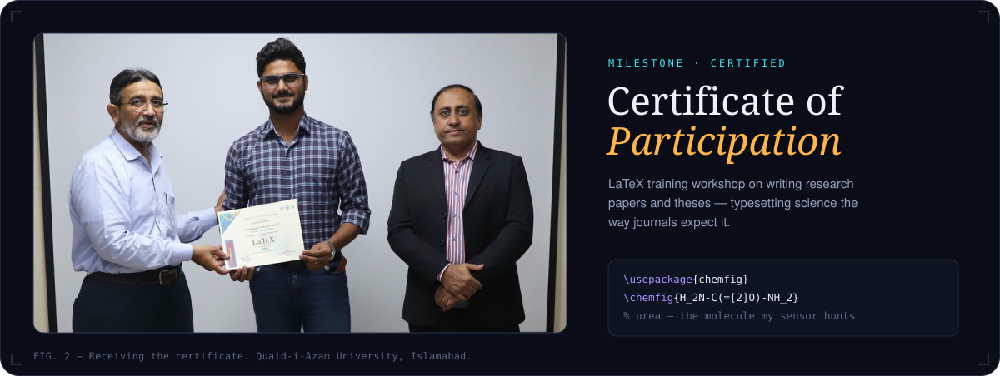</picture>

<b>Lab notebook</b> — methods & instruments

 

| | |
| :-- | :-- |
| **Synthesis** | Plant-mediated (green) CaO nanoparticles from *Syzygium cumini* extract |
| **Recognition layer** | Molecularly imprinted polyaniline (PANi) — urea-shaped cavities left after template removal |
| **Characterisation** | FTIR, UV-Vis, electrochemical response |
| **Computation** | Density functional theory with Quantum ESPRESSO — geometry optimisation, phonons, vibrational spectra |
| **Writing** | LaTeX, reproducible figures, literature pipelines built with [ArticlesDownloader](https://github.com/Kamran5H/ArticlesDownloader) & [ReviewForge](https://github.com/Kamran5H/ReviewForge) |

 

<picture><source media="(prefers-color-scheme: dark)" srcset="https://raw.githubusercontent.com/Kamran5H/Kamran5H/main/assets/svg/h-telemetry-dark.svg"><source media="(prefers-color-scheme: light)" srcset="https://raw.githubusercontent.com/Kamran5H/Kamran5H/main/assets/svg/h-telemetry-light.svg"></picture>

<picture><source media="(prefers-color-scheme: dark)" srcset="https://raw.githubusercontent.com/Kamran5H/Kamran5H/output/stats-dark.svg"><source media="(prefers-color-scheme: light)" srcset="https://raw.githubusercontent.com/Kamran5H/Kamran5H/output/stats-light.svg"></picture>

<picture><source media="(prefers-color-scheme: dark)" srcset="https://raw.githubusercontent.com/Kamran5H/Kamran5H/output/snake-dark.svg"><source media="(prefers-color-scheme: light)" srcset="https://raw.githubusercontent.com/Kamran5H/Kamran5H/output/snake-light.svg"></picture>

 

<picture><source media="(prefers-color-scheme: dark)" srcset="https://raw.githubusercontent.com/Kamran5H/Kamran5H/main/assets/svg/h-contact-dark.svg"><source media="(prefers-color-scheme: light)" srcset="https://raw.githubusercontent.com/Kamran5H/Kamran5H/main/assets/svg/h-contact-light.svg"></picture>

<a href="mailto:chkamran32b@gmail.com"><picture><source media="(prefers-color-scheme: dark)" srcset="https://raw.githubusercontent.com/Kamran5H/Kamran5H/main/assets/svg/contact-email-dark.svg"><source media="(prefers-color-scheme: light)" srcset="https://raw.githubusercontent.com/Kamran5H/Kamran5H/main/assets/svg/contact-email-light.svg"></picture></a>
<a href="https://github.com/Kamran5H"><picture><source media="(prefers-color-scheme: dark)" srcset="https://raw.githubusercontent.com/Kamran5H/Kamran5H/main/assets/svg/contact-github-dark.svg"><source media="(prefers-color-scheme: light)" srcset="https://raw.githubusercontent.com/Kamran5H/Kamran5H/main/assets/svg/contact-github-light.svg"></picture></a>
<a href="https://qaukalam.me"><picture><source media="(prefers-color-scheme: dark)" srcset="https://raw.githubusercontent.com/Kamran5H/Kamran5H/main/assets/svg/contact-kalam-dark.svg"><source media="(prefers-color-scheme: light)" srcset="https://raw.githubusercontent.com/Kamran5H/Kamran5H/main/assets/svg/contact-kalam-light.svg"></picture></a>
<a href="https://github.com/Kamran5H/Portfolio"><picture><source media="(prefers-color-scheme: dark)" srcset="https://raw.githubusercontent.com/Kamran5H/Kamran5H/main/assets/svg/contact-portfolio-dark.svg"><source media="(prefers-color-scheme: light)" srcset="https://raw.githubusercontent.com/Kamran5H/Kamran5H/main/assets/svg/contact-portfolio-light.svg"></picture></a>

  

<picture><source media="(prefers-color-scheme: dark)" srcset="https://raw.githubusercontent.com/Kamran5H/Kamran5H/main/assets/svg/footer-dark.svg"><source media="(prefers-color-scheme: light)" srcset="https://raw.githubusercontent.com/Kamran5H/Kamran5H/main/assets/svg/footer-light.svg"></picture>

