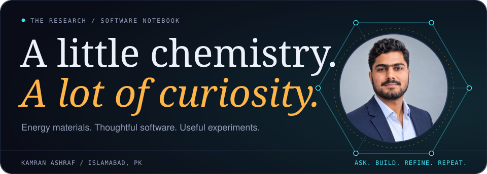
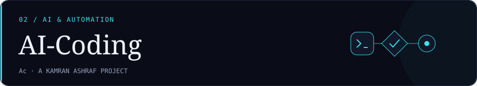

<!-- Generated by scripts/build_readme.py. Edit profile_data.py or the generator. -->

<picture>
  <source media="(max-width: 600px) and (prefers-color-scheme: light)" srcset="assets/profile/hero-mobile-light.svg">
  <source media="(max-width: 600px)" srcset="assets/profile/hero-mobile-dark.svg">
  <source media="(prefers-color-scheme: light)" srcset="assets/profile/hero-light.svg">
  
</picture>

# Muhammad Kamran Ashraf

**MPhil Chemistry Researcher · Scientific Software Developer** 
Quaid-i-Azam University, Islamabad, Pakistan

I study energy materials and build software that makes research and everyday work easier. My work connects **electrocatalysis**, **computational chemistry**, and **practical tools built with Python and JavaScript**.

**[Portfolio](https://kamranashraf.is-a.dev)** · **[Public CV](https://kamranashraf.is-a.dev/cv/KAMRAN-ASHRAF-CV.pdf)** · **[Get in touch](#lets-connect)**

[Selected work](#selected-work) · [Project directory](#project-directory) · [In the lab](#in-the-lab) · [Toolkit](#toolkit)

---

## Selected work

Tools shaped by real workflows: finding a paper, exploring an agent, or making room for focused work. Open a project to read its setup, or expand the notes here.

### [Articles Downloader](https://github.com/Kamran5H/ArticlesDownloader)

<picture>
  <source media="(max-width: 600px) and (prefers-color-scheme: light)" srcset="assets/profile/articlesdownloader-mobile-light.svg">
  <source media="(max-width: 600px)" srcset="assets/profile/articlesdownloader-mobile-dark.svg">
  <source media="(prefers-color-scheme: light)" srcset="assets/profile/articlesdownloader-light.svg">
  
</picture>

Find scholarly papers across multiple databases, review the results, and collect open-access PDFs with citation exports.

**Built with:** Python · SQLite · Scholarly APIs · BibTeX / RIS

Inside the project

Federated search brings together nine documented scholarly sources, DOI deduplication, local search history, and exports for reference managers. Browser, desktop, and command-line interfaces support different research workflows. Provider availability, API keys, and publisher access determine what can be retrieved.

[Explore the code & setup →](https://github.com/Kamran5H/ArticlesDownloader#readme)

### [AI-Coding](https://github.com/Kamran5H/AI-Coding)

<picture>
  <source media="(max-width: 600px) and (prefers-color-scheme: light)" srcset="assets/profile/ai-coding-mobile-light.svg">
  <source media="(max-width: 600px)" srcset="assets/profile/ai-coding-mobile-dark.svg">
  <source media="(prefers-color-scheme: light)" srcset="assets/profile/ai-coding-light.svg">
  
</picture>

Explore a local coding agent with a browser interface, streamed responses, and human approval before shell commands.

**Built with:** JavaScript · Node.js · Express · Server-sent events

Inside the project

The agent reads and edits project files through a tool loop. Its web interface streams progress and asks a human to approve shell commands. Source and setup notes document the tool loop, workspace restrictions, and approval flow.

[Explore the code & setup →](https://github.com/Kamran5H/AI-Coding#readme)

### [Subah TaskBook](https://github.com/Kamran5H/Subah-TaskBook)

<picture>
  <source media="(max-width: 600px) and (prefers-color-scheme: light)" srcset="assets/profile/subah-taskbook-mobile-light.svg">
  <source media="(max-width: 600px)" srcset="assets/profile/subah-taskbook-mobile-dark.svg">
  <source media="(prefers-color-scheme: light)" srcset="assets/profile/subah-taskbook-light.svg">
  
</picture>

A quieter daily planner: carry unfinished tasks into tomorrow, keep a reflective journal, and work offline.

**Built with:** Electron · JavaScript · Local storage

Inside the project

A daily focus queue, task rollover, journal entries, and completion rewards share one desktop application. Personal records stay on the device without a required cloud account. Local storage makes device backups part of the workflow.

[Explore the code & setup →](https://github.com/Kamran5H/Subah-TaskBook#readme)

**Community project — [QAU Kalam](https://qaukalam.me)** 
A platform for student conversations, mentorship, and campus information at Quaid-i-Azam University. More context in my [portfolio case study](https://kamranashraf.is-a.dev).

## Project directory

A curated collection of research tools, desktop utilities, and experiments. Expand a field to explore it.

<b>Research & writing</b> · 2 projects

- **[ReviewForge](https://github.com/Kamran5H/ReviewForge)** — Config-driven workflows for academic review writing.
- **[ResearchDaybook](https://github.com/Kamran5H/ResearchDaybook)** — An offline research journal in a single HTML file.

<b>Everyday tools</b> · 6 projects

- **[Quidian-MediaDownloader](https://github.com/Kamran5H/Quidian-MediaDownloader)** — Media, playlist, and subtitle downloads with yt-dlp and a web dashboard.
- **[GmailZenith](https://github.com/Kamran5H/GmailZenith)** — Inbox rules and bulk workflows using the Gmail API.
- **[DiskOptimizerPro](https://github.com/Kamran5H/DiskOptimizerPro)** — Windows cleanup and duplicate-file tools.
- **[ChromeMonitor](https://github.com/Kamran5H/ChromeMonitor)** — Chrome profile, extension, and resource monitoring.
- **[AutoClearExtension](https://github.com/Kamran5H/AutoClearExtension)** — A Chrome extension for clearing browsing data.
- **[FacebookCleaner](https://github.com/Kamran5H/FacebookCleaner)** — Browser-driven tools for account cleanup workflows.

<b>Data & creative experiments</b> · 7 projects

- **[SourceGenius](https://github.com/Kamran5H/SourceGenius)** — Brand-website discovery with browser automation.
- **[SourceGenius-Share](https://github.com/Kamran5H/SourceGenius-Share)** — A deployment bundle for the SourceGenius tools.
- **[BrandScrapers](https://github.com/Kamran5H/BrandScrapers)** — Brand extraction and data-cleaning utilities.
- **[TikTokProductHunter](https://github.com/Kamran5H/TikTokProductHunter)** — Product discovery across Amazon and TikTok Shop.
- **[Urdu-Poetry-Studio](https://github.com/Kamran5H/Urdu-Poetry-Studio)** — Urdu typography and poetry artwork.
- **[VideoStudio](https://github.com/Kamran5H/VideoStudio)** — A Gradio interface for generative-video workflows.
- **[Humanizer](https://github.com/Kamran5H/Humanizer)** — Text-rewriting experiments and heuristic scoring.

<b>Web & beginnings</b> · 2 projects

- **[Portfolio](https://github.com/Kamran5H/Portfolio)** — Research, software case studies, and my public CV.
- **[Early-Coding-Archive](https://github.com/Kamran5H/Early-Coding-Archive)** — Early Python, desktop, and machine-learning experiments.

[Browse all public repositories →](https://github.com/Kamran5H?tab=repositories)

## In the lab

My ongoing MPhil research explores **Ce-doped NiCo metal–organic frameworks for electrocatalysis**, with oxygen and hydrogen evolution as the water-splitting reactions of interest. I work under **Prof. Dr. Safeer Ahmed** at Quaid-i-Azam University.

Alongside this, I use **DFT workflows in Quantum ESPRESSO** to investigate electronic structure and adsorption energetics, connecting atomistic questions with experimental chemistry.

Research interests & earlier work

- **Literature & analysis:** air-electrode activity and degradation in rechargeable zinc–air batteries.
- **Undergraduate projects, University of the Punjab:** green-synthesized CaO nanoparticles for dye degradation and urea sensing; Cu-supported titanium oxide catalysts for methyl orange degradation.
- **Research practice:** LaTeX, reproducible figures, spectroscopy, and tools for literature discovery and citation exports.

[Research overview & public CV →](https://kamranashraf.is-a.dev) · [ORCID](https://orcid.org/0009-0003-2997-2954)

## Toolkit

| Field | Tools I work with |
| :-- | :-- |
| Research | Quantum ESPRESSO · DFT · Electrochemistry · UV–Vis / IR · Origin |
| Scientific computing | Python · NumPy / SciPy · SQLite · Literature APIs |
| Web & desktop | JavaScript / TypeScript · React / Next.js · FastAPI · Electron |
| Automation & delivery | Playwright · Chrome Manifest V3 · GitHub Actions · Azure |

On GitHub · activity & contribution artwork

The card below uses public repository data and the publicly visible contribution calendar. Language shares describe **repository bytes**, rather than skill or proficiency. The timestamp on the card shows its last successful refresh; the workflow runs twice daily.

<picture>
  <source media="(prefers-color-scheme: light)" srcset="https://raw.githubusercontent.com/Kamran5H/Kamran5H/output/stats-light.svg">
  
</picture>

[View activity on GitHub](https://github.com/Kamran5H?tab=overview) · [Open the full-size statistics card](https://raw.githubusercontent.com/Kamran5H/Kamran5H/output/stats-dark.svg) · [Refresh workflow](https://github.com/Kamran5H/Kamran5H/actions/workflows/profile.yml)

<picture>
  <source media="(prefers-color-scheme: light)" srcset="https://raw.githubusercontent.com/Kamran5H/Kamran5H/output/snake-light.svg">
  
</picture>

---

## Let's connect

Interested in chemistry research, scientific software, or a thoughtful automation project? Share the question you are working on.

**[chkamran32b@gmail.com](mailto:chkamran32b@gmail.com)** 
[Email](mailto:chkamran32b@gmail.com) · [LinkedIn](https://www.linkedin.com/in/kamran-ashraf-762a21363/) · [ORCID](https://orcid.org/0009-0003-2997-2954) · [Portfolio](https://kamranashraf.is-a.dev)

From a question in the lab to a useful tool on the desk.
